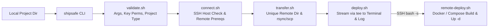

# ShipSafe

ShipSafe is a lightweight, Bash-based SSH remote deployment tool. It lets developers deploy Docker and Docker Compose applications from a local directory to a remote Linux server over OpenSSH while streaming all deployment output to the local terminal and saving a timestamped local log file.

## Architecture

ShipSafe separates local orchestration from remote execution. No ShipSafe daemon, database, or YAML deployment manifest is required.



## Technology Stack

- **Bash** — CLI and deployment orchestration
- **OpenSSH (`ssh`)** — Secure remote connectivity and command execution
- **rsync / scp** — Application file transfer (prefers `rsync`, falls back to `scp`)
- **Docker & Docker Compose** — Remote image building and detached container lifecycle
- **ShellCheck** — Static analysis for all Bash scripts
- **Bats** — Automated Bash test suite
- **GitHub Actions** — CI for linting and testing

## Prerequisites

### Local Machine
- Bash 4+ (or Bash 5+)
- OpenSSH client (`ssh`)
- `rsync` or `scp`
- `date`, `tee`, `basename`, `stat`

### Remote Linux Machine
- SSH server (`sshd`) with key-based authentication enabled
- User account with permission to run `docker` (e.g., member of the `docker` group)
- Docker Engine and Docker Compose plugin (`docker compose`)

## Installation

```bash
git clone <repository-url>
cd ShipSafe
chmod +x shipsafe scripts/*.sh
```

Optionally symlink `shipsafe` into your `PATH`:

```bash
ln -s "$(pwd)/shipsafe" /usr/local/bin/shipsafe
```

## SSH Setup

1. Generate an SSH key pair if you do not already have one:
   ```bash
   ssh-keygen -t ed25519 -f ~/.ssh/id_ed25519
   ```
2. Copy the public key to the remote server:
   ```bash
   ssh-copy-id -i ~/.ssh/id_ed25519.pub deploy@192.168.1.50
   ```
3. Verify host identity and add the remote host to `~/.ssh/known_hosts`:
   ```bash
   ssh -i ~/.ssh/id_ed25519 deploy@192.168.1.50 "echo ok"
   ```
4. Ensure private key permissions are restricted (`0600` or `0400`):
   ```bash
   chmod 600 ~/.ssh/id_ed25519
   ```

## Usage

```bash
./shipsafe deploy ./my-project \
  --host 192.168.1.50 \
  --user deploy \
  --key ~/.ssh/id_ed25519
```

### Options

| Flag | Description | Default |
| --- | --- | --- |
| `--host` | Remote server IP address or hostname | Required |
| `--user` | SSH username on the remote server | Required |
| `--key` | Path to the SSH private key | Required |
| `--port` | SSH port | `22` |
| `--timeout` | SSH connection timeout in seconds | `30` |
| `--log-dir` | Local directory for deployment logs | `~/.shipsafe/logs` |

## Supported Deployment Formats

ShipSafe detects standard container files automatically without a custom YAML manifest:

1. **Docker Compose** (`compose.yaml`, `compose.yml`, `docker-compose.yaml`, `docker-compose.yml`):
   Runs `docker compose build`, `docker compose up -d`, and verifies running containers with `docker compose ps`.
2. **Docker** (`Dockerfile`):
   Builds a unique image tag and starts a detached container with `docker run -d`, verifying that it remains running.

If neither is present, ShipSafe exits with an error rather than guessing startup commands.

## How Log Streaming Works

`deploy.sh` runs the deployment pipeline with `set -o pipefail` and pipes `stdout` and `stderr` through `tee -a <log_file>`:

- Output streams to your local terminal in real time.
- Logs are written incrementally to `~/.shipsafe/logs/shipsafe-<app>-<timestamp>.log` without buffering the full log in memory.
- No deployment logs are stored on the remote server by ShipSafe.

## Error Handling and Security

- **Host-key verification**: `StrictHostKeyChecking=yes` is always enforced; unknown or mismatched host keys fail immediately.
- **Non-interactive SSH**: `BatchMode=yes` and `IdentitiesOnly=yes` prevent hanging on password prompts.
- **Key safety**: Private key permissions are checked (`0600`/`0400`), and key contents are never read or printed.
- **Input validation**: Hostnames, usernames, ports, and timeouts are validated before constructing commands, and remote arguments are escaped with `printf '%q'`.
- **Isolated remote directories**: Each deployment goes into `~/shipsafe-deployments/shipsafe-<app>-<timestamp>-<pid>` so unrelated files and containers are never touched.
- **SSH interruption (exit `255`)**: Reported explicitly as a connection drop without falsely claiming success, noting that remote processes already started may continue running.

## Testing and Linting

Run ShellCheck and the Bats test suite locally:

```bash
shellcheck shipsafe scripts/*.sh
bats tests/deploy.bats
```

## Current Limitations

- Supports Docker and Docker Compose projects only; bare-metal Node.js/Python/JVM runtimes are not yet supported.
- Does not automatically clean up older deployment directories or containers (by design, to avoid destructive cleanup).
- Assumes the remote user already has `docker` and `docker compose` installed and accessible.
